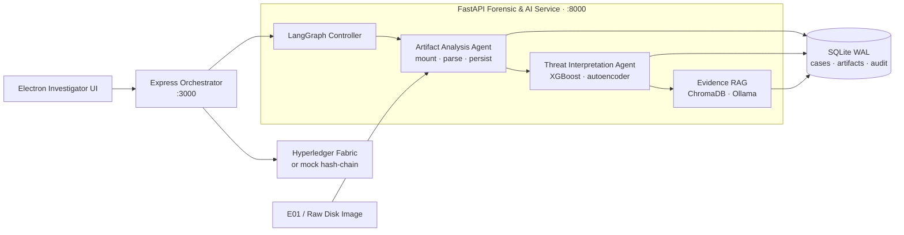

<div align="center">

# Agentic Blockchain Forensics

### Multi-Agent Digital Investigation with Blockchain-Backed Evidence Integrity

An offline-first desktop platform that ingests forensic disk images, coordinates specialist AI agents, detects suspicious activity with hybrid ML, answers evidence-grounded questions, and records chain-of-custody events on Hyperledger Fabric.

[](https://www.python.org/)
[](https://www.langchain.com/langgraph)
[](https://www.hyperledger.org/projects/fabric)
[](https://www.electronjs.org/)
[](https://ollama.com/)
[]()

[Capabilities](#what-this-project-demonstrates) · [Architecture](#architecture) · [Quick Start](#quick-start) · [Investigation Flow](#typical-investigation-flow)

</div>

---

## What This Project Demonstrates

| Skill area | Implementation |
|------------|----------------|
| **Agentic AI** | LangGraph coordinates a collection/parsing agent, a distinct ML threat-interpretation agent, and evidence indexing in a deterministic pipeline |
| **Digital forensics** | Streamed E01/raw image ingestion, filesystem metadata walk, Windows Registry, EVTX, browser history, Prefetch, scheduled tasks, Recycle Bin, and LNK extraction |
| **Evidence integrity** | Acquisition hash + independently streamed system hash, auditable case events, and optional Hyperledger Fabric chaincode |
| **Applied ML** | XGBoost threat classification combined with autoencoder anomaly detection over engineered forensic features |
| **Private AI / RAG** | ChromaDB evidence index, sentence-transformer embeddings, and evidence-grounded Ollama answers that run locally |
| **Full-stack systems** | Electron desktop UI → Express orchestration API → FastAPI forensic/AI service with SQLite WAL persistence |

### Core capabilities

- **Specialist multi-agent workflow** — artifact collection and threat interpretation are separate agents with distinct responsibilities and outputs
- **Forensic image support** — segmented E01 (`.E01`, `.E02`, …) and raw images (`.001`, `.dd`, `.img`, `.raw`)
- **Blockchain-backed custody** — Fabric gateway + JavaScript chaincode, with a tamper-evident SQLite mock ledger for local setup
- **Offline investigation chat** — tool-assisted, evidence-grounded responses through Ollama (`qwen2.5:3b`)
- **Dual integrity verification** — preserves the acquisition hash and computes a SHA-256 system hash without loading the image into memory
- **Investigator workspace** — case management, evidence browsing, threat scores, blockchain verification, chat, and HTML reports

---

## Runtime at a Glance

| Layer | Runtime | Port |
|-------|---------|------|
| Electron UI | WSL2 (WSLg) | — |
| Node.js API | WSL2 | `3000` |
| Python AI service | WSL2 | `8000` |
| Ledger | Mock SQLite *(default)* or Hyperledger Fabric | — |
| LLM | Ollama (`qwen2.5:3b`) | `11434` |

---

## Contents

1. [What this project demonstrates](#what-this-project-demonstrates)
2. [Quick start](#quick-start)
3. [Architecture](#architecture)
4. [Tech stack](#tech-stack)
5. [Prerequisites](#prerequisites)
6. [Full setup](#full-setup)
7. [Run the app](#run-the-app)
8. [Typical investigation flow](#typical-investigation-flow)
9. [Blockchain modes](#blockchain-modes)
10. [Testing and scope](#testing-and-scope)
11. [Configuration](#configuration)
12. [Project layout](#project-layout)
13. [Troubleshooting](#troubleshooting)

---

## Quick start

After prerequisites are installed, this is the shortest path from clone to a running stack. **Everything below runs in WSL2.**

```bash
# 1) Clone
git clone https://github.com/Syed-Abdul-Rehman-Nasir/agentic-blockchain-forensics.git
cd agentic-blockchain-forensics

# 2) Python
python3.11 -m venv .venv
source .venv/bin/activate
pip install -r requirements.txt

# 3) Node (API + UI)
(cd backend-node && npm install)
(cd ui && npm install)

# 4) Env (mock chain — no Docker)
cp backend-node/.env.example backend-node/.env
# Edit OLLAMA_HOST if Ollama runs on Windows (see Setup step 4)

# 5) Start stack (three WSL terminals)
bash scripts/start-ai-service.sh          # terminal 1 — AI :8000
bash scripts/start-backend.sh             # terminal 2 — API :3000
bash scripts/start-ui.sh                  # terminal 3 — Electron UI
# (or: cd ui && npm start)

# 6) Health checks
curl -s http://localhost:8000/health
curl -s http://localhost:3000/health
```

Place a forensic image (`.E01`, `.001`, `.dd`, `.img`, `.raw`) in `data/test_images/`, then create a case from the UI.

---

## Architecture



| Responsibility | Where it runs |
|----------------|---------------|
| Investigator UI | **WSL2** Electron app (window via WSLg) |
| API orchestration + blockchain client | **WSL2** Node backend |
| Disk parsing, ML, RAG, reports | **WSL2** Python service |
| LLM inference | Ollama on Windows *(recommended)* or WSL2 |

The UI never talks directly to Python or Fabric. The Node service is the
orchestration boundary: **UI → Node → AI service / ledger**. Analysis results
are persisted before asynchronous blockchain writes, so ledger availability
cannot destroy forensic results.

---

## Tech Stack

| Layer | Technology |
|-------|------------|
| Agent orchestration | LangGraph, typed shared state, sequential specialist agents |
| Forensic processing | pytsk3, libewf ctypes bindings, python-registry, python-evtx |
| Threat analytics | XGBoost, PyTorch autoencoder, engineered forensic features |
| Retrieval and LLM | ChromaDB, SentenceTransformers, Ollama (`qwen2.5:3b`) |
| AI service | Python 3.11, FastAPI, Uvicorn |
| API orchestration | Node.js, Express, Fabric Gateway SDK |
| Evidence ledger | Hyperledger Fabric chaincode or local SQLite hash-chain |
| Persistence | SQLite in WAL mode |
| Desktop interface | Electron, HTML, CSS, vanilla JavaScript |

---

## Prerequisites

### Windows host

| Tool | Why | Install |
|------|-----|---------|
| WSL2 + Ubuntu 22.04 | Runs the full stack | Microsoft Store / `wsl --install` |
| WSLg | Shows the Electron window from WSL | Built into modern Windows 11 WSL |
| Ollama | Offline LLM | [ollama.com/download](https://ollama.com/download) |

### WSL2 (Ubuntu)

Install system packages once:

```bash
sudo apt update
sudo apt install -y \
  python3.11 python3.11-venv python3.11-dev \
  build-essential libssl-dev \
  libewf-dev libewf2 ewf-tools libafflib-dev \
  tmux wget p7zip-full
```

| Package | Why |
|---------|-----|
| Python 3.11 + venv/dev | AI service (see `.python-version`) |
| build-essential, libssl-dev | Native Python wheels |
| libewf*, ewf-tools, libafflib-dev | E01 / disk image support |
| tmux | Optional one-command start (`run-agentic-forensics.sh`) |
| wget, p7zip-full | Optional test-image download / extract |

Node.js 18+ in WSL2 (backend **and** UI):

```bash
curl -fsSL https://deb.nodesource.com/setup_18.x | sudo -E bash -
sudo apt install -y nodejs
```

### Ollama models

On the machine where Ollama is installed (usually Windows):

```bash
ollama serve          # if not already running
ollama pull qwen2.5:3b
```

Evidence embeddings use the bundled SentenceTransformers model
`all-MiniLM-L6-v2`; no separate Ollama embedding model is required.

### Docker *(optional — real Fabric only)*

Only needed if you set `USE_REAL_FABRIC=true`. Install [Docker Desktop](https://www.docker.com/products/docker-desktop/) with WSL2 integration (or Docker Engine in Ubuntu) and [fabric-samples](https://hyperledger-fabric.readthedocs.io/en/latest/install.html) under `~/fabric-samples`.

### Disk space

Large E01 cases need free space for the image, SQLite (`data/forensic.db`), and ChromaDB. Plan on **≥ 2× image size** free under the WSL filesystem (not only Windows `C:`).

---

## Full setup

### 1. Clone

```bash
git clone https://github.com/Syed-Abdul-Rehman-Nasir/agentic-blockchain-forensics.git
cd agentic-blockchain-forensics
```

### 2. Python virtualenv

```bash
python3.11 -m venv .venv
source .venv/bin/activate
pip install --upgrade pip
pip install -r requirements.txt
```

<details>
<summary><strong>Note:</strong> CUDA PyTorch pin (<code>torch==2.7.1+cu118</code>)</summary>

If `pip` cannot find that build, install Torch from the official CUDA 11.8 index first, then re-run requirements:

```bash
pip install torch==2.7.1+cu118 --index-url https://download.pytorch.org/whl/cu118
pip install -r requirements.txt
```

CPU-only hosts can install a matching CPU wheel from [pytorch.org](https://pytorch.org) instead, then install the remaining packages.
</details>

### 3. Node dependencies

```bash
cd backend-node && npm install && cd ..
cd ui && npm install && cd ..
```

### 4. Environment file

```bash
cp backend-node/.env.example backend-node/.env
```

Minimum edits for a first successful run:

| Variable | Recommended first value | Notes |
|----------|-------------------------|--------|
| `USE_REAL_FABRIC` | `false` | Uses local mock chain — no Docker |
| `AI_SERVICE_URL` | `http://127.0.0.1:8000` | Leave as-is for local WSL |
| `PORT` | `3000` | Node API |
| `OLLAMA_HOST` | see below | Must reach Ollama from WSL |
| `OLLAMA_MODEL` | `qwen2.5:3b` | Local chat/tool-calling model |

**Ollama from WSL2 when Ollama runs on Windows:**

```bash
# In WSL — discover Windows host IP
grep nameserver /etc/resolv.conf | awk '{print $2}'
# Then in backend-node/.env:
# OLLAMA_HOST=http://<that-ip>:11434
```

If Ollama runs inside WSL, keep `OLLAMA_HOST=http://localhost:11434`.

`scripts/start-ai-service.sh` automatically loads `backend-node/.env`.

### 5. Branding & investigator profile *(optional)*

Edit [`backend-node/config/app.config.json`](backend-node/config/app.config.json) to match your organisation. The shipped values (`orgName` / `orgMark` / investigator name) are placeholders and **can be changed freely** — they do not affect Fabric, AI, or case data:

- Organisation name, mark, subtitle, and window title
- Investigator name, initials, role, chain ID, workspace
- Chat quick-query presets

Changes apply on the next app start (restart Node / Electron if already running).

### 6. Forensic image

```text
data/test_images/   ← put your .E01 / .001 / .dd / .img / .raw here
```

The directory is kept in git via `.gitkeep`; images themselves are gitignored.

#### Optional — download BSidesAmman21.E01 (Internet Archive)

Windows CTF disk image (~5.3 GB after extract; ~5 GB as five 7z parts). Needs ~10 GB free while downloading + extracting.

```bash
cd data/test_images
sudo apt install -y p7zip-full wget   # once, if needed

# Download all five 7z parts (~1 GB each; -c resumes if interrupted)
for i in 001 002 003 004 005; do
  wget -c --show-progress \
    "https://archive.org/download/BSidesAmman21.E01/BSidesAmman21.E01.7z.$i" \
    -O "BSidesAmman21.E01.7z.$i"
done

ls -lh BSidesAmman21.E01.7z.*

# Extract (open .001 only — 7z pulls in .002–.005 automatically)
7z x BSidesAmman21.E01.7z.001

ls -lh BSidesAmman21.E01

# Optional: free ~5 GB after the E01 is present
rm -v BSidesAmman21.E01.7z.00{1,2,3,4,5}
```

Source: [archive.org/download/BSidesAmman21.E01](https://archive.org/download/BSidesAmman21.E01).

---

## Run the app

All commands below are run from the project root in **WSL2**. Start Ollama on Windows first if that is where the model lives.

### Option A — Manual start *(recommended first time)*

Keep each process in its own terminal so logs stay visible.

| # | Terminal | Command |
|---|----------|---------|
| 1 | WSL | `source .venv/bin/activate && bash scripts/start-ai-service.sh` |
| 2 | WSL | `bash scripts/start-backend.sh` |
| 3 | WSL | `bash scripts/start-ui.sh` *(or `cd ui && npm start`)* |

### Option B — tmux helper

```bash
sudo apt install tmux   # once, if needed
bash scripts/run-agentic-forensics.sh start
bash scripts/run-agentic-forensics.sh status
```

Then launch the UI in another WSL terminal:

```bash
bash scripts/start-ui.sh
```

Useful controls:

```bash
bash scripts/run-agentic-forensics.sh stop
bash scripts/run-agentic-forensics.sh attach
```

### Verify

```bash
curl -s http://localhost:8000/health   # expect "status":"ok" + model info
curl -s http://localhost:3000/health   # expect "status":"ok"
# Ollama (use the same host as in .env)
curl -s "$OLLAMA_HOST/api/tags"        # should list qwen2.5:3b
```

---

## Typical investigation flow

1. Start AI + Node + UI (see [Run the app](#run-the-app)).
2. In the UI, create a case and select an image under `data/test_images/` (WSL path, e.g. `/home/<user>/…/BSidesAmman21.E01`).
3. Wait until case status reaches **complete** (large images can take 15–60+ minutes). Status polls automatically.
4. Use chat / evidence views to ask questions; answers come from indexed artifacts via the offline LLM.
5. Generate a report when ready (saved under `data/reports/`).
6. With mock chain (`USE_REAL_FABRIC=false`), custody records land in `data/chain.db`. With Fabric, they go on-chain after analysis.

Do not close the AI terminal while a case is analysing — ingest and hashing run there.

---

## Blockchain modes

| Mode | `.env` | Needs Docker? | Storage |
|------|--------|---------------|---------|
| **Mock chain** *(default)* | `USE_REAL_FABRIC=false` | No | `data/chain.db` |
| **Hyperledger Fabric** | `USE_REAL_FABRIC=true` | Yes | Fabric test-network |

### Switch to real Fabric

Requires Docker and fabric-samples at `~/fabric-samples`.

```bash
# Always use these scripts — they clean half-down state and regenerate
# missing crypto so configtxgen / :7051 timeouts do not recur.
bash scripts/stop-fabric.sh    # clean teardown (safe if already down)
bash scripts/start-fabric.sh   # reset → channel → CCAAS → peer health check
```

Success means `docker ps` shows **`peer0.org1.example.com`**, CCAAS containers, and **`fabric-peer-proxy`** on **`:17051`** (not only CCAAS leftovers).

On Docker Desktop / WSL2, host `:7051` can keep a stale TLS proxy after crypto regenerate. `start-fabric.sh` always points the app at **`localhost:17051`** via a fresh socat sidecar and writes `backend-node/.fabric-endpoints.env` (loaded by `server.js` / `start-backend.sh`).

Then set `USE_REAL_FABRIC=true` in `backend-node/.env` and restart the Node backend.

```bash
bash scripts/stop-fabric.sh    # clean shutdown later (peers + leftover CCAAS)
```

---

## Testing and Scope

### Tests

```bash
# Python unit/integration suite (skip multi-GB image tests)
source .venv/bin/activate
pytest -m "not slow"

# API smoke test — requires AI and Node services running
node tests/node/test_ui_api_smoke.js

# Live Fabric integration — requires the Fabric network and chaincode
node tests/node/test_blockchain.js
```

### Current scope

- Windows disk forensics is the supported analysis path in this release.
- The application is designed for one investigator on one workstation.
- The bundled ML models are research models, not a substitute for examiner judgment.
- Hyperledger Fabric is optional; mock-chain mode makes onboarding and demos easier.
- Large images are streamed, but full filesystem walks can still take significant time.
- Forensic test images and generated case databases are intentionally excluded from Git.

---

## Configuration

| File | Purpose |
|------|---------|
| [`backend-node/.env`](backend-node/.env.example) | Fabric mode, ports, service URLs, Ollama host |
| [`backend-node/config/app.config.json`](backend-node/config/app.config.json) | Branding & investigator profile (edit freely; placeholders ship by default) |
| [`requirements.txt`](requirements.txt) | Python AI service dependencies |
| [`.python-version`](.python-version) | Expected Python major.minor (`3.11`) |

Never commit a real `.env` — only `.env.example` is tracked.

---

## Project layout

```text
├── ai_service/       FastAPI — parsers, agents, RAG, ML, reports
├── backend-node/     Express orchestrator + Fabric / mock chain
│   ├── config/       app.config.json
│   ├── routes/       REST API
│   └── services/     AI proxy, orchestration, ledger clients
├── chaincode/        Hyperledger Fabric chaincode (JavaScript)
├── data/             Runtime data (gitignored; placeholders kept)
│   ├── chromadb/     Vector index
│   ├── reports/      Generated HTML reports
│   └── test_images/  Drop forensic images here
├── models/           Trained ML artefacts (regenerated locally)
├── scripts/          start-ai-service / start-backend / start-ui / Fabric / tmux
├── tests/            Integration and smoke tests
└── ui/               Electron desktop app
    └── renderer/     Frontend views
```

---

## Troubleshooting

| Symptom | Fix |
|---------|-----|
| Ollama unreachable from WSL | Set `OLLAMA_HOST=http://<Windows-host-IP>:11434` from `/etc/resolv.conf` nameserver; confirm `ollama serve` on Windows |
| Python import / missing module | `source .venv/bin/activate` then `pip install -r requirements.txt` |
| `torch==…+cu118` not found | Install from PyTorch CUDA index (see Setup step 2 note) |
| Fabric connection refused / DEADLINE_EXCEEDED on :7051 | Stale Docker port or peer down. Use `PEER_ENDPOINT=localhost:17051`, then `bash scripts/stop-fabric.sh && bash scripts/start-fabric.sh`, restart Node, or set `USE_REAL_FABRIC=false` |
| configtxgen missing orderer `server.crt` | Crypto was half-deleted. `start-fabric.sh` purges incomplete orgs and regenerates — use that script, not a bare `network.sh up` |
| Electron window never opens | Confirm WSLg (`echo $DISPLAY`). Retry: `cd ui && npx electron . --no-sandbox`. Reinstall UI deps: `cd ui && rm -rf node_modules && npm install` |
| Port already in use | Stop old processes or change `PORT` / avoid a second uvicorn on `8000` |
| UI online but AI “down” | Confirm Python health on `:8000` and that Node `AI_SERVICE_URL` matches |
| Case stuck on mounting / analysing | Keep the AI terminal open; large E01 walks are slow. Watch logs every ~10k files |

**Disk image cannot be mounted / pytsk3 import error / “No mountable NTFS”**

E01 support needs the system **libewf** library (not a pip package — `pip install pyewf` does not work on PyPI).

```bash
sudo apt update
sudo apt install -y libewf2 libewf-dev ewf-tools libafflib-dev libssl-dev \
                   build-essential python3.11-dev
source .venv/bin/activate
pip install pytsk3
```

The AI service opens E01s via `ai_service/parsers/ewf_bindings.py` (ctypes → `libewf.so`).
Modern `pytsk3` wheels are **not** linked with libewf; opening an `.E01` through
`pytsk3.Img_Info` alone returns the compressed file size (~container) instead of
the logical media size and mount fails.

Verify:
```bash
ewfinfo /path/to/image.E01          # shows Media size
python -c "from ai_service.parsers.ewf_bindings import handle, glob; \
 h=handle(); h.open(glob('/path/to/image.E01') or ['/path/to/image.E01']); \
 print(h.get_media_size()); h.close()"
```

If `pip install pytsk3` fails with a compiler error, try:
```bash
pip install pytsk3 --no-binary :all:
```

**Large E01 image appears to hang during analysis**

This is normal for images over 2 GB. The system indexes file metadata and
parses artifacts while computing the integrity hash in the background.
The analysis pipeline will complete — watch the terminal running the AI
service for progress logs every 10,000 files. The hash appears in the
Evidence Vault once background hashing finishes (typically 5–20 minutes
per GB depending on hardware and E01 compression).

**Confirm Ollama models:**

```bash
curl -s "$OLLAMA_HOST/api/tags"   # should list qwen2.5:3b
```

---

## License

Copyright © 2026 Syed Abdul Rehman Nasir. All rights reserved.

This repository is published as a portfolio and research prototype. No
commercial-use or redistribution rights are granted unless explicitly
authorized by the copyright holder.
